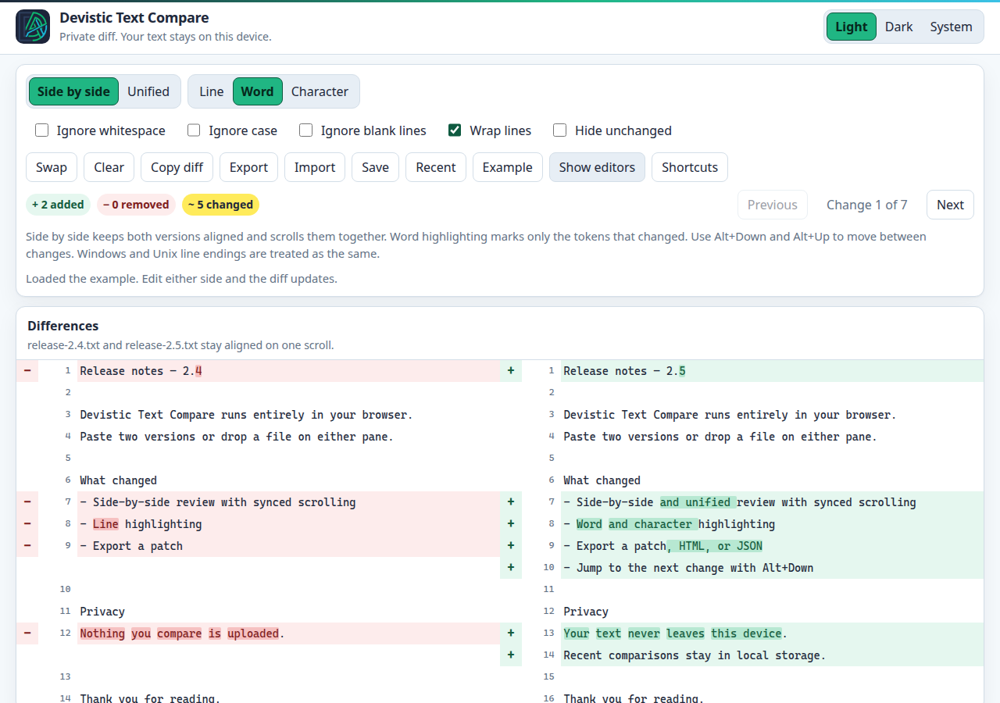
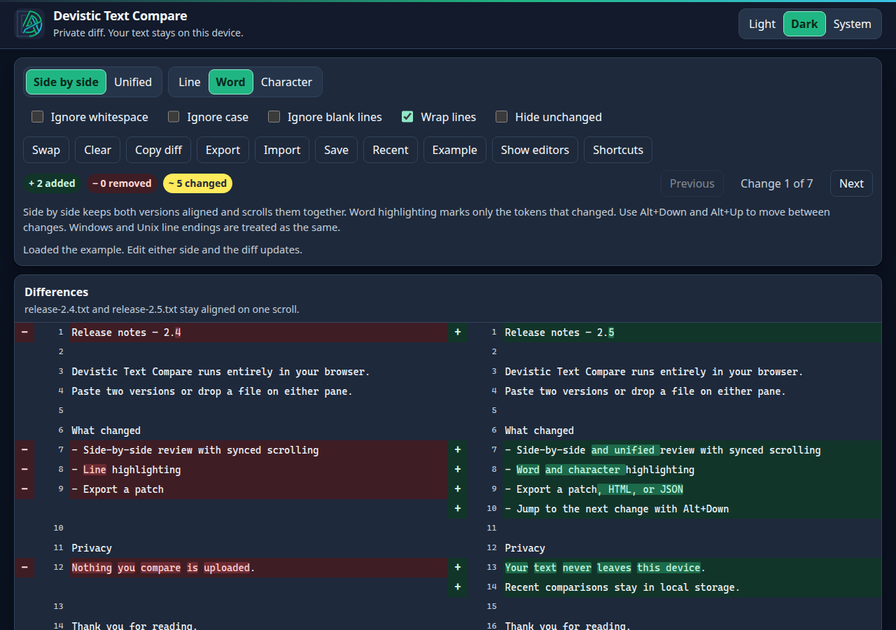
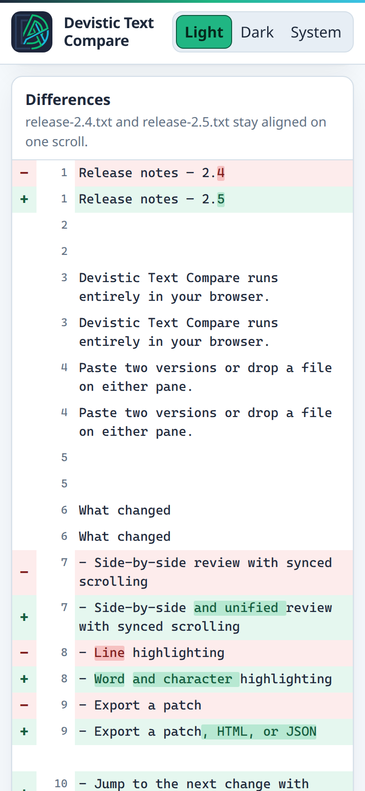

# Devistic Text Compare

A free, one-page text diff that runs entirely in your browser. Paste two versions, drop files, and see what changed by line, word, or character. Nothing is uploaded.

**Live app:** [https://devistic-asim.github.io/devistic-text-compare/](https://devistic-asim.github.io/devistic-text-compare/)

The site is published with GitHub Actions. After the first deploy, the repository owner needs **Settings → Pages → Source → GitHub Actions**.







## Features

- Two panes, Original and Changed, with paste, file upload, and drag-and-drop.
- Side-by-side view with aligned line numbers and one shared scroll, or a unified view in the same shape as a Git diff.
- Line, word, and character highlighting. Word is the default, because that is usually the fastest way to see an edit inside a line.
- Ignore whitespace, ignore case, and ignore blank lines. Ignored lines stay visible so the alignment is still honest; they are just not highlighted or counted.
- Swap sides, clear, and copy a unified diff.
- Counts for added, removed, and changed lines, plus next and previous change (buttons, `Alt+↓` / `Alt+↑`, and `N` / `P` outside a text field).
- Large comparisons are diffed with [jsdiff](https://github.com/kpdecker/jsdiff) on a background thread, and very long results are windowed so the page stays responsive.
- Recent comparisons, settings, and the in-progress draft stay in `localStorage` and `sessionStorage` on this device.
- Export `.diff`, `.patch`, a standalone HTML report, a comparison JSON, or a backup of settings and saved comparisons. Import either JSON back in.
- Light, dark, and system themes, applied before first paint. Clear local data from the footer.

The patch download is an exact transform from the original text to the changed text, so it can be applied with `patch`. Ignore options change what is highlighted, not the patch.

## How to use

1. Paste into Original, or drop a text file on the pane. Do the same for Changed.
2. Read the highlights. Red is removed, green is added, and the yellow chip counts lines that were edited rather than only inserted or deleted.
3. Switch to Unified when you want a single column, or turn on Hide unchanged for a long file.
4. Use Next and Previous, or `Alt+↓` and `Alt+↑`, to walk the changes.
5. Export a diff, patch, HTML report, or JSON. Save keeps a copy in Recent on this device.

Load Example if you want a short sample before pasting your own text.

## Tech stack

- Vite, React, and TypeScript
- [`diff`](https://github.com/kpdecker/jsdiff) (jsdiff) for the comparison and the applicable patch
- A module web worker for larger texts
- Vitest for the diff, export, and storage logic
- Oxlint
- GitHub Actions for CI and GitHub Pages

No backend, no account, no analytics, and no third-party fonts or scripts.

## Run locally

```bash
npm install
npm run dev
```

Then open the URL Vite prints (usually `http://localhost:5173/`).

```bash
npm test
npm run lint
npm run typecheck
npm run build
npm run preview
```

The production build uses the base path `/devistic-text-compare/`, which is what GitHub Pages project sites expect. `npm run build` also copies `index.html` to `404.html` so deep links on Pages still load the app.

## Privacy

We don't use cookies for tracking and we don't collect or store your data on any server. Everything stays in your browser on this device.

Saved comparisons, the theme, and other settings live in `localStorage`. The text you are currently editing is also kept in `sessionStorage` so a refresh does not throw it away. Use **Clear my local data** in the footer to delete all of it. You can export or import that data as JSON from the Export and Import buttons.

## Contributing

See [CONTRIBUTING.md](CONTRIBUTING.md). Please keep user text on the client.

## License

[MIT](LICENSE) © devistic-asim

## Contact

[github.com/devistic-asim](https://github.com/devistic-asim)
